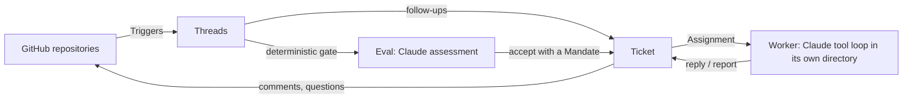

# superagent

A proactive coding agent for your team's GitHub repositories, powered by Claude.

superagent watches any number of repositories. When someone on the team mentions it in an Issue or pull request, it
decides whether that is a request for work, opens a ticket, works on it in its own directory with its own Claude
session, and answers in the original conversation, usually with a pull request. A small web panel shows only what
needs a person.

It is built around one rule: **take as little human attention as possible, and give as much value as possible.**
The agent acts only when asked or when a rule the team wrote allows it, confirms a request once, stays quiet while it
works, and speaks again only with a result, one concrete question, or an honest failure.
[docs/000-philosophy.md](docs/000-philosophy.md) explains the principle.

> **Status:** an early prototype. Review it before pointing it at repositories that matter, start with a short
> allowed list, and keep proactive rules in `observe` mode until their recorded decisions look right.

## How it works



- **A gate before any model.** Who may ask for work is checked by code from each Source's allowed list, bot list and
  admission table. No message, comment or prompt can widen it.
- **Mandates.** An accepted request becomes a Ticket with an immutable Mandate: its scope, its requester, the rules it
  relied on and the policy version. Wider scope needs a new Ticket.
- **Follow-ups go to the work they belong to.** A person's comment on a Ticket's Issue or pull request reaches that
  Ticket's worker directly; the worker handles it or hands it back. Ended Tickets resume when a person writes again.
- **Many repositories, one agent.** One deployment watches any number of repositories; Tickets of different
  repositories run side by side, each with the right repository in its environment. Groups of repositories can have
  different allowed lists.
- **Store first, act after.** Decisions, launches, Inputs and outgoing messages are stored before they happen, so a
  restart loses and repeats nothing.
- **A panel that answers three questions:** what needs me, is the system healthy, and what happened to one piece of
  work.

## Quick start

```sh
git clone https://github.com/onurkagan/superagent.git && cd superagent
python -m venv .venv && . .venv/bin/activate
pip install -e ".[dev]"

python examples/offline_demo.py --serve   # the whole flow with a scripted model: no API key, no GitHub
```

To run it for real:

```sh
export ANTHROPIC_API_KEY=...          # or: ant auth login
gh auth login                         # as the account the agent acts as
superagent init                       # writes superagent.toml
$EDITOR superagent.toml               # repositories, allowed people
superagent doctor
superagent run                        # panel at http://127.0.0.1:8765/
```

Then mention the agent's account in an Issue of a watched repository, for example
`@my-agent please add a CONTRIBUTING.md`.

## Configuration

```toml
[model]
worker = "claude-opus-5-5"
worker_effort = "high"

[execution]
concurrency = 3
prepare = 'git clone --quiet "https://github.com/$SUPERAGENT_GITHUB_REPOSITORY.git" "$SUPERAGENT_NAME" && git -C "$SUPERAGENT_NAME" switch -c "$SUPERAGENT_NAME"'

[policy]
mode = "observe"

# One source watching several repositories with one allowed list.
[sources.github]
repositories = ["acme/api", "acme/web", "acme/docs"]
allowed = ["alice", "bob"]
bots = ["dependabot[bot]"]

# Another group of repositories with a different allowed list.
[sources.infra]
kind = "github"
repositories = ["acme/terraform"]
allowed = ["carol"]
```

Every setting is described in [docs/006-deployment.md](docs/006-deployment.md). Behaviour the team describes in words,
such as when to stop with a draft or what a pull request must contain, lives in editable prompt sections:
`superagent prompts eject team/delivery`.

## Command line

| Command | What it does |
| --- | --- |
| `superagent init` / `doctor` | Write a configuration template / check it, credentials and repository access |
| `superagent run` | Run the agent and its panel |
| `superagent status` | What needs you, problems, the last 24 hours |
| `superagent tickets [--all]`, `show <id>` | List tickets / show one in detail |
| `superagent stop <id>`, `retry <id>` | Stop a ticket / retry a blocked or failed one |
| `superagent pause`, `resume`, `reevaluate <trigger>` | Control processing |
| `superagent say "..."`, `replies` | Talk to the agent through the local inbox source |
| `superagent prompts list\|show\|eject <part>` | Inspect and customise prompts |

## Documentation

Read the numbered documents in order; each builds only on the ones before it.

- [000 Philosophy](docs/000-philosophy.md)
- [001 Domain model](docs/001-domain.md)
- [002 Authorization](docs/002-authorization.md)
- [003 Execution](docs/003-execution.md)
- [004 Prompts](docs/004-prompts.md)
- [005 Panel](docs/005-panel.md)
- [006 Deployment](docs/006-deployment.md)
- [007 Architecture](docs/007-architecture.md)
- [008 Cookbook: adding a Source](docs/008-cookbook.md)

## Development

```sh
pip install -e ".[dev]"
pytest
```

The suite runs in seconds without network access: the domain against an in-memory store, Sources against a fake
`gh`, and the runtime end to end against a scripted model. See [CONTRIBUTING.md](CONTRIBUTING.md).

## Acknowledgements

The design is inspired by DeepSeek's
[dsh-superagent prototype](https://github.com/deepseek-ai/dsh-superagent-prototype) and its write-up on super-agent
design. superagent is an independent Python implementation; [docs/007-architecture.md](docs/007-architecture.md)
lists how it differs.

## License

[MIT](LICENSE)
