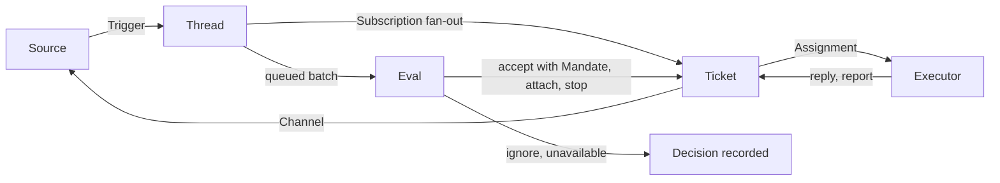

# 001 Domain model

This document names the concepts of superagent and the rules each one keeps. Code, prompts, the panel and the later
documents use these words and no others. It builds on [000 Philosophy](000-philosophy.md).

## Flow



A Source turns outside events into Triggers. Each Trigger belongs to one or more Threads. A Trigger fans out to the
Tickets subscribed to its Threads; a person's message that a Ticket owns stays with that Ticket. Every other admitted
Trigger waits on its Thread for an Eval, which decides whether it asks for new work. An accepted Eval creates a Ticket
with a Mandate. An Assignment hands the Ticket to the Executor, and results go back through a Channel.

## Concepts

| Concept | What it is | Rules it keeps |
| --- | --- | --- |
| Source | A configured stream of events, such as one GitHub account watching several repositories, or a local inbox. Each instance has a name; several instances may share a kind | Keeps its own read position, so a restart does not replay events. Drops the agent's own messages and everything outside what it listens to. Names each Trigger's Threads and Channels |
| Trigger | One immutable event: a new Issue, a comment, a review comment, a pull request closing | Accepting the same Trigger twice changes nothing. Carries its sender as the Source names it, and whether it addresses the agent |
| Thread | The Triggers of one conversation, in order. On GitHub, one Issue or pull request: `github:owner/name#12` | At most one Eval runs on it at a time. Holds its Subscriptions, its queue for Eval and its Decisions |
| Channel | Where a reply goes: a conversation, optionally answering one message in it | A Ticket may hold several Channels |
| Policy | The versioned rules for accepting work: the accept mode, the proactive rules, and each Source's allowed list, bot list and admission table | Every change makes a new version. Identities of different Sources are never mapped to each other |
| Eval | The judgement of a batch of Triggers from one Thread: a deterministic gate, then routing by the orchestrator or a one-off assessment | Holds no state of its own; it ends in a Decision |
| Decision | The result of an Eval: `accept`, `attach`, `stop`, `ignore` or `unavailable` | Recorded with its reason, its strength and the Policy version |
| Mandate | What an accept grants: the scope, the strength, the matched rules, the requester and the Policy version | Immutable. Wider scope needs a new Ticket. Only a stop withdraws it: a person's, or the orchestrator's when a person asked or the Ticket duplicates another. A Policy that no longer holds it revokes it when the Ticket tries to resume |
| Ticket | A unit of authorized work | Only an Eval creates one. It goes from open to ended and back to open when a person's message resumes it, unless a person stopped it |
| Input | Something delivered to a Ticket's worker: a message, a routing note, an orchestrator note or status request, a policy notice, a resume or recovery note | Tracked as delivered and read, so a restart neither loses nor repeats it |
| Assignment | The binding of a Ticket to one run of the Executor | A Ticket has several over time. Goes pending, running, ended. Only the current one may report |
| Report | What the worker says about its Ticket: `progress`, `waiting`, `ready`, `blocked`, `failed` or `dropped` | A question for a person travels in a Report, never as free text |
| Subscription | A Ticket following a Thread | A message on a subscribed Thread reaches every live subscribed Ticket. A context-only Subscription delivers messages but grants no ownership |

A person is not a domain concept. A Trigger carries its sender's login as given by the Source; an allowed list is a
Source's part of the Policy. That one person has accounts on several Sources is prompt text.

The Executor, its sessions and directories are outside the domain; they connect through Assignments.

## Many repositories

One deployment can watch any number of repositories. A GitHub Source lists them in `repositories`; Thread keys,
Channels and execution variables carry the repository, so Tickets of different repositories run side by side
without sharing anything but the worker slots. Repositories that need a different allowed list go into a second
GitHub Source instance:

```toml
[sources.backend]
kind = "github"
repositories = ["acme/api", "acme/worker"]
allowed = ["alice", "bob"]

[sources.frontend]
kind = "github"
repositories = ["acme/web"]
allowed = ["carol"]
```

A repository belongs to exactly one Source instance. A Ticket works on one repository: the one its first message
came from.

## Ownership of follow-ups

A person's message on a Thread that a live Ticket follows belongs to that Ticket: it goes to its worker, not to Eval.
The worker either handles it within the Ticket's scope or hands it back with a reason, and only then does the message
become a candidate for new work. A Ticket that ended without being stopped keeps its Subscriptions, so a person's
later message resumes it under the same Mandate after the Mandate is checked again. Messages from bots and CI reach
live Tickets as context, never resume ended ones, and are judged by the gate on their own.

## Glossary of values

| Group | Values |
| --- | --- |
| Decision | accept · attach · stop · ignore · unavailable |
| Strength | explicit · inferred |
| Accept mode | off · observe · auto |
| Assignment | pending · running · ended |
| Report | progress · waiting · ready · blocked · failed · dropped |
| Ticket outcome | completed · dropped · stopped · merged · closed |
