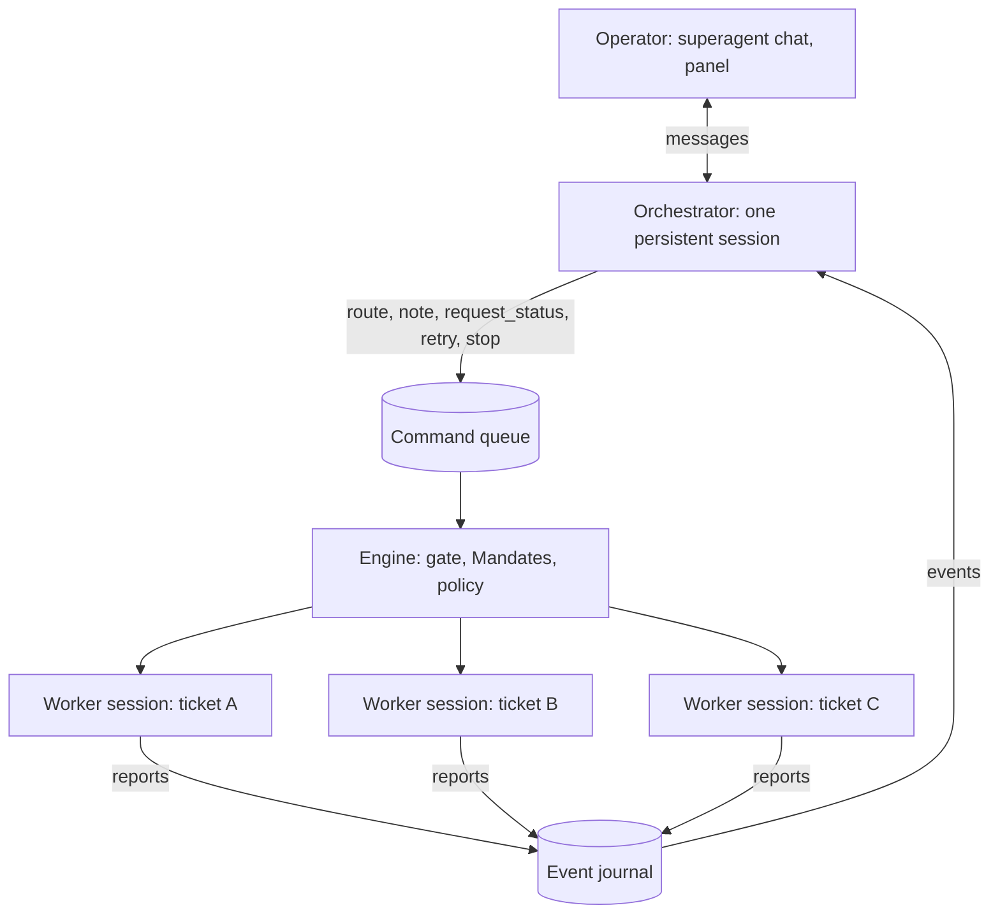

# 009 Orchestrator

How superagent oversees all of its work with one persistent session. It builds on [001 Domain model](001-domain.md)
through [007 Architecture](007-architecture.md).

## Why

Every Ticket has its own worker: a Claude session in its own directory. Several run at once, across many
repositories, and none of them sees the others. Somebody has to see all of them together:

- route a new request knowing what is already being worked on;
- notice that two tickets change the same files, or that one depends on another's pull request;
- restart a ticket that failed for a passing reason;
- answer the operator's "what is going on?" and act on "stop that one".

That is the orchestrator: one long-lived Claude session over every Ticket, every worker session and every
conversation the agent watches.



## What wakes it

The runtime checks every second whether something needs the orchestrator. Then it waits `batch_seconds` for more to
arrive, and runs one turn with everything as one update. Only one turn runs at a time; what arrives during a turn goes
into the next.

| Wakes it | Context for its next turn only |
| --- | --- |
| A candidate to route (with `route = true`) | A ticket created, resumed or retried |
| A message from the operator | A person's follow-up that went straight to the tickets that own it |
| A worker report other than `progress` | A hand-back, a decision, a policy change, a pause |
| A ticket that ended, unless the orchestrator stopped it | |
| A failed delivery | |

## What it reads

Each turn is one `<update>` message with:

- `<operator>`: the operator's messages since the last turn;
- `<candidate>`: the same candidate cards the assessor reads (see [004 Prompts](004-prompts.md));
- `<events>`: one line per event since the last turn, naming tickets by name;
- a line on which worker sessions are running and how many wait for a slot.

The update holds facts, not the whole history. The orchestrator looks up the rest with its reading tools.

## Tools

| Tool | What it does |
| --- | --- |
| `list_tickets` | Tickets across every repository: stage, whether a worker session runs now, pull requests, latest report |
| `read_ticket` | One ticket by id or name: Mandate, decision, reports, Inputs, messages sent |
| `read_conversation` | One conversation's latest messages with what happened to each, and the tickets that follow it |
| `route` | Decide a candidate: accept, attach, stop or ignore, with the same fields the assessor fills |
| `note` | Give a worker a fact from other work, at most 150 words |
| `request_status` | Ask a worker to report where its ticket stands |
| `retry` | Start a new Assignment for a ticket that waits after a blocked or failed report |
| `stop_ticket` | Stop a ticket, when a person asked or it duplicates another |
| `reevaluate` | Send a stored message to evaluation again |
| `notify` | Message a ticket's conversation, for a person who must act and whom no worker can tell |
| `set_processing` | Pause or resume processing, when the operator asks |

The orchestrator has no shell or file tools. It cannot read or change code.

## What code enforces

Acting tools never call the Engine. They queue a command, the runtime applies it on its next tick, and the tool
returns the outcome, so the Engine checks each action exactly as it checks a click in the panel:

- A `route` accept passes the gate and the Policy. An inferred candidate without an enabled rule is recorded as
  `ignore` whatever the orchestrator asked for, and the result says so.
- A note is an Input of kind `orchestrator`: it never changes the Mandate, and a held ticket (blocked or failed,
  waiting for a person) reads it only after a person writes or someone retries.
- A status request is not queued twice for the same ticket.
- `notify` goes through the same reply checks as a worker's message: an open ticket, at most 150 words.
- A stop by the orchestrator records `orchestrator` as who ended the ticket.

## When a turn fails

The chat records the error and the panel shows the orchestrator's last turn as failed. Candidates the failed turn held
go to the assessor, one structured call each, so routing never depends on the orchestrator alone. A candidate the
orchestrator leaves undecided twice also goes to the assessor. Operator messages of a failed turn are not repeated;
send them again.

## Talking to it

```sh
superagent chat "Which tickets are open, and do any of them overlap?"
superagent chat                 # an interactive conversation; Ctrl-D ends it
superagent chat --history       # the conversation so far, including what it did on its own
superagent chat --reset         # the next turn starts a new session
```

The panel's *Orchestrator* section shows the same conversation, whether a turn is running, and a box to write in.
After every turn it took on its own, the orchestrator writes one line there on what it did. It answers in the
language the operator last used.

## Backends

| Backend | A turn | History |
| --- | --- | --- |
| `claude-code` | One `claude -p --resume` process in `<state_dir>/orchestrator`, with no built-in tools; the tools come from the MCP bridge in its orchestrator role (`SUPERAGENT_ROLE=orchestrator`), which opens the same database | Claude Code's session, which it compacts itself |
| `anthropic` | A tool loop over the Messages API in the agent's process | `<state_dir>/orchestrator/session.json`, cleared with a note once it passes about 400,000 characters; the store, not the history, holds the truth |

## Settings

| Setting | Default | Meaning |
| --- | --- | --- |
| `orchestrator.enabled` | `false`; `superagent init` writes `true` | Run the orchestrator |
| `orchestrator.route` | `true` | The orchestrator routes candidates; `false` keeps one assessment call per candidate |
| `orchestrator.model` | `claude-opus-5-5` | The orchestrator's model |
| `orchestrator.effort` | `medium` | Its effort level |
| `orchestrator.batch_seconds` | `3` | How long it waits for more news before a turn |
| `orchestrator.turn_timeout_seconds` | `900` | Longest turn |

## Cost

Every turn is a model request, or a `claude -p` process with the `claude-code` backend. Expect about one turn per
worker report, per batch of candidates and per operator message. With `route = false` the orchestrator still
coordinates and answers, and routing goes back to the cheaper per-candidate assessment. With `enabled = false` there is
no orchestrator at all, as in earlier versions.

## Differences from the reference prototype

DeepSeek's main Session has fourteen tools, including saving settings, policy and prompts, and a shell. superagent's
orchestrator has the eleven above, no shell and no configuration tools: configuration stays in `superagent.toml` and
prompt files. Workers, not the orchestrator, acknowledge requests and deliver results in the conversations they came
from, so the orchestrator speaks to people only when no worker can.
